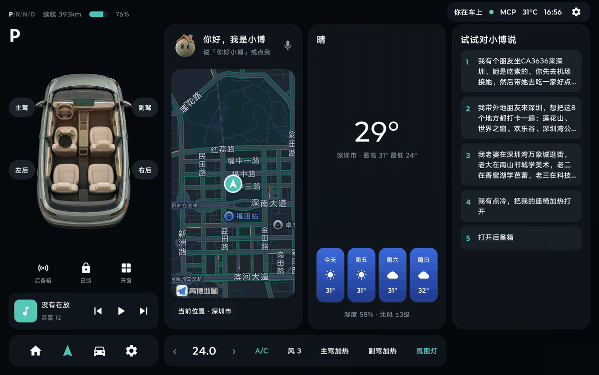
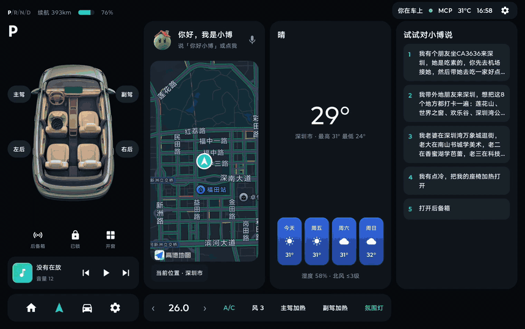
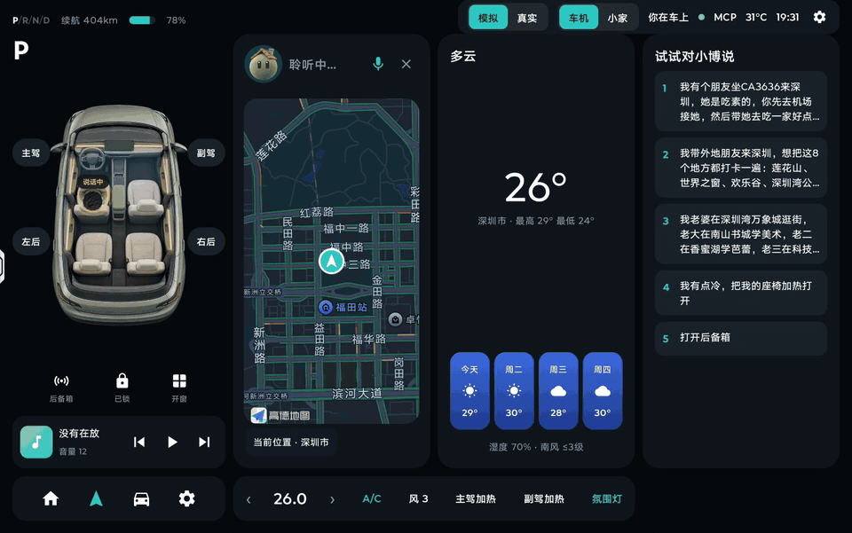
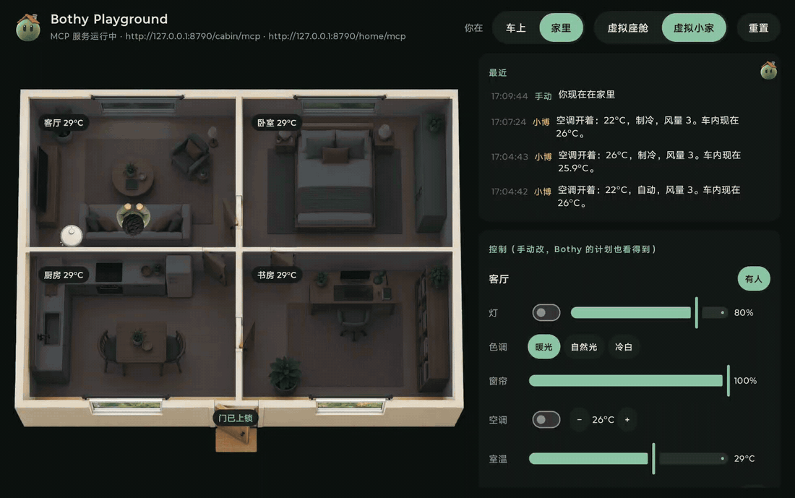
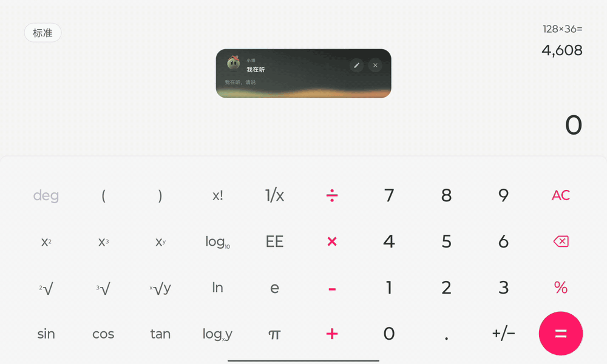
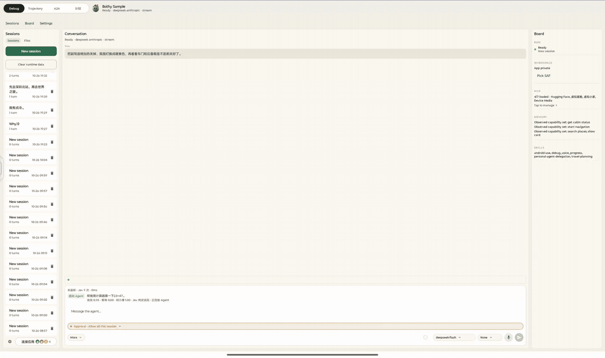
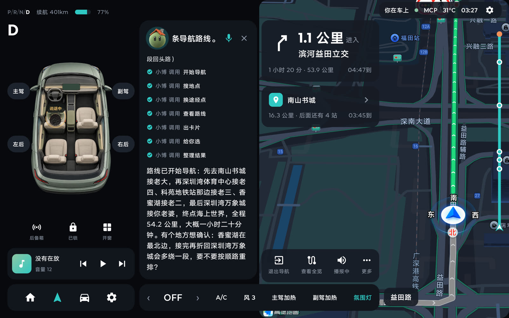

# Bothy

[](LICENSE)
[](https://github.com/NoHarry/android-agent-runtime)
[](#环境要求)

<p align="center"></p>

[English](README.md) | **中文**

**Bothy 是 [Android Agent Runtime](https://github.com/NoHarry/android-agent-runtime)（可嵌入的 Android agent 运行时）的平板优先演示。**

Bothy（苏格兰山间小屋）向所有路人开放。小博就住在里面：一个能对话的悬浮助手，会操作别的 App、连公开的 MCP 服务、按计划盯着外面的变化，还能开一辆模拟的车、管一个模拟的家。agent 做的每件事都走运行时的公开 API；这个仓库里没有库。

> **状态：0.x，持续开发中。**

## 两个 App

| 模块 | 做什么 |
|------|--------|
| `bothy-sample` | 演示 App（平板优先）：调试控制台、设置、计划、语音、悬浮助手卡片 |
| `bothy-playground` | 第二个演示 App：用本机 MCP 服务提供一辆虚构的车和一个虚构的家，给 Bothy 操作（见[下文](#bothy-playground)） |

sample 依赖运行时的构件（`cc.noharry:agent-*`）；playground 不依赖任何模块，Bothy 像连其他 MCP 服务一样连它。

## 演示 App 能看到什么

下面每段动图都是演示 App 在平板上实际运行、对着它说话录下来的；部分片段加了速，说明里都标了。

### 在车里和小博说话

<p align="center"></p>

说「你好小博」再提要求。它听的时候只显示一条小栏，滚动显示听到的字；接下请求后，卡片里依次出现你说的话、它调用的每个工具和最后的回答。它知道是谁在说话：标着「说话中」的座位就是你的，所以「我这边好热」会落到这个座位上。这里说「我有点冷」，空调从 24 度调到 26 度。*（原速）*

### 规划行程，开过去

<p align="center"></p>

「先去深圳北站，再去世界之窗」：小博按名字找到两个地点，用高德导航 SDK 规划经过它们的路线，先完整展示几秒，再开始模拟行驶和逐向引导。开车途中可以增加、删除、替换途经点或调整顺序（最多 16 个）；「科技园」这类笼统的名字会在行程其他地点附近找。演示里车停在深圳市民中心，不用设备的真实位置。*（2 倍速）*

### 它画给你的卡片和面板

<p align="center"></p>

需要你选择或调节的时候，小博直接发界面而不是一段话（A2UI）：信息卡、选项、调节面板都由车机自己绘制。拖一拖、点一点、确定，选择就发回给小博执行；这里是 22 度、制冷。*（1.6 倍速）*

### 还有一个家

<p align="center"></p>

Playground 里还有一个小家：四个房间的灯、窗帘和空调，每个房间的人体传感器，门锁，扫地机器人，以及回家、离家、睡觉、观影、起床几个场景。数据会动，所以上面的客厅会慢慢降向 25 度，「客厅超过 28 度就开空调」这样的计划几分钟内就会触发。不在车机界面时，小博在 Bothy 的悬浮卡片里回答。*（1.5 倍速）*

### 它会用别的 App

<p align="center"></p>

打开 Android Use（一个需要你手动开启的无障碍服务）后，小博能读屏幕，在别的 App 里点击、滑动和输入。它的头像会提示马上要点哪里，它在操作时屏幕边缘会亮起；这里它在计算器上算出了 23 × 47。*（1.3 倍速）*

### 每一步都有记录

<p align="center"></p>

Bothy 本身的界面是一个类似 Codex 的开发者控制台。对话区列出每一次工具调用、各自的耗时和中途说的话；右侧 Board 跟踪这次运行、token 用量和缓存命中、工作区、MCP 服务、记忆和 skill。Trajectory 页从持久化的事件日志回放一次运行：先是模型和工具的时间轴，再按顺序列出每个事件，从请求、每次模型调用和 token 数，到每次工具调用（模型发起、后端执行、完成），并行执行的调用也一目了然。这里小博关掉副驾座椅加热、把氛围灯换成暖色，并检查车门和后备箱。*（1.15 倍速；以往的会话已隐去）*

### 还有这些

- **自带模型**：任何 OpenAI 或 Anthropic 兼容的服务，在 App 里配置；服务支持时可用流式、思考、服务端联网搜索和提示缓存。
- **接入公网上的 MCP**：「连接应用」里预置了现成的远程 MCP。公开服务点一下就能连，不需要 key：Kiwi.com 机票搜索、DeepWiki（GitHub 仓库问答）、Hugging Face Hub、Context7（开发文档）。需要 key 的填你自己的：高德地图、滴滴出行、麦当劳、瑞幸咖啡、腾讯文档。其他 Streamable HTTP 的 MCP 服务也可以按地址添加。
- **skill 和子 agent**：多日旅行规划会分派交通、住宿、每日行程三个子 agent，汇总成一张行程卡片；何时委派由主 agent 决定。
- **计划**：提醒、定时任务，以及监听服务状态（MCP 资源，或按间隔调用的只读工具）。比如「深圳飞成都 11 月 7 日的最低价低于 800 元时提醒我」就跑在 Kiwi.com 的公开搜索上。
- **语音**：设备端唤醒词（「你好，小博」）和识别、轮次判断（可选的判断服务决定你是否说完、是不是在对小博说）、插话打断、语音播报；也可以切换到端到端语音模型。
- **你自己的云端 agent**：通过 `workspace/apps/android/tools/agent-relay` 里自部署的中转，配对你的个人 agent（例如 Grok Bot），把需要个人账号的事交给它。
- **离线**：也可以用模拟模型和 `bothy-sample/src/main/assets/mcp/tools.json` 里的示例工具完全离线运行。

## Bothy Playground

<p align="center"></p>

`bothy-playground` 是另一个 App，它模拟一辆车的座舱和一个小家，在本机提供两个 MCP 服务
（`http://127.0.0.1:8790/cabin/mcp` 和 `/home/mcp`，Streamable HTTP，只监听本机回环地址）。它不连接任何真车或真实设备。

- **座舱**：空调、座椅加热和通风、车窗、车门和后备箱、车门锁、中控屏亮度和音量、氛围灯、音乐；还有谁坐在哪、谁在说话，所以「我这边好热」会落到说话人的座位上。
- **导航**：打包时配了高德 key，就用高德导航 SDK 真实算路：按名字找地点（「科技园」这种笼统的名字会在这趟行程其他地点附近找），
  最多 16 个途经点，开车途中加、删、换、调整途经点，沿途搜索，以及模拟行驶。设置里可以让车停在深圳市民中心，不用设备的真实位置，方便在演示城市里演示。
- **车机界面**：座舱按车机屏幕布局（左边是车，右边三栏，下面是空调条）。它在前台时接管助手：Bothy 收起悬浮卡片，小博就在车机里。
  在这里唤醒（唤醒词，或者点小博）；听你说话时只显示一条小栏，滚动显示识别到的字；识别完开始干活时才弹出卡片，显示你的要求、
  它的思考过程（中文）、调用的每个工具、干活时说的话，最后是回答；计划到点也显示在这里；点 X 退出语音。地图会移到它找到的每个地点，先展示整条算好的路线，然后才开始导航。
- **小家**：四个房间的灯、窗帘、空调，每个房间的人体传感器，入户门锁，扫地机，以及场景（回家、离家、睡觉、观影、起床）。
- **读数会变**：温度会朝空调设定或室外温度变化，「模拟行驶」会耗电、缩短导航距离，所以「车里降到 24 度以下就把车窗都关上」、
  「客厅超过 28 度就开空调」这类计划几分钟内就会触发。两个服务都把状态发布成资源（`playground://cabin/state`、
  `playground://home/state`），Bothy 的计划可以监听。
- **也能手动改**：点座位让人上下车，长按座位让那里的人说话，点房间开关灯；侧栏里有全部控件和读数。手动改的会在记录里标「手动」，
  和真实变化一样会触发计划。

演示方法：两个 App 都装上，先打开 Bothy Playground，再在 Bothy 的「连接应用」里连上「虚拟座舱」和「虚拟小家」（不需要 key）。
让 Playground 留在前台，直接在车机里跟小博对话。电脑上的 MCP 客户端可以用 `adb forward tcp:8790 tcp:8790` 连同样的服务。

导航需要你自己的高德 Android key，绑定包名 `cc.noharry.bothy.playground` 和你签名用的 SHA1：在
`workspace/apps/android/local.properties` 里写 `AMAP_ANDROID_KEY=…`（这个文件不会提交）。没有 key 时导航工具会说明缺什么。
车机接管助手靠签名级权限，所以两个 App 要用同一个签名（签名方法见[运行演示 App](#运行演示-app)）。

## 运行演示 App

把运行时 clone 到本仓库旁边，Gradle 会从源码构建它，代替已发布的构件（见 `settings.gradle.kts`；加 `-PagentRuntimeDir=` 则用已发布的 `agentRuntimeVersion`）：

```bash
git clone https://github.com/NoHarry/android-agent-runtime.git
git clone https://github.com/NoHarry/bothy.git
cd bothy/workspace/apps/android
./gradlew :bothy-sample:assembleDebug
./gradlew :bothy-playground:assembleDebug   # 可选：给 Bothy 操作的车和家
```

模型服务预置来自 `bothy-sample/src/main/assets/model-provider-profiles.json`，它会打进 APK，所以**不含任何 API key**。
key 写在被 Git 忽略的 `workspace/apps/android/local.properties`：

```properties
# local.properties（永不提交）
AGENT_RUNTIME_PROVIDER_PROFILE_DEEPSEEK_API_API_KEY=your-key
```

key 名为 `AGENT_RUNTIME_PROVIDER_PROFILE_{PROFILE_ID}_API_KEY`，profile id 转大写、`-` 换成 `_`。为了方便，
`local.properties` 里的 key 会编进 debug 包；要发给别人的 APK 请加 `-PsampleEmbedLocalKeys=none`（或 `tts`）构建，
或者在 App 里填 key。

两个 App 默认用本机的调试签名；`local.properties` 里指定了自己的签名文件时，debug 和 release 都用它签，
换哪台电脑打的包都能覆盖安装：

```properties
BOTHY_SIGNING_STORE_FILE=/仓库外的路径/bothy-release.jks
BOTHY_SIGNING_STORE_PASSWORD=…
BOTHY_SIGNING_KEY_ALIAS=bothy
BOTHY_SIGNING_KEY_PASSWORD=…
```

签名文件和密码要备份好：丢了以后，新打的包就不能覆盖安装旧的了。

设备端语音模型已经提交在仓库里（sherpa-onnx 原生库随运行时的 `agent-voice` 提供），arm64 设备上开箱即用；
`tools/voice/fetch_voice_assets.py` 可以重新下载并校验它们。

## 环境要求

- 演示 App：`minSdk 24`、`compileSdk 37`（运行时用到 `java.nio.file`，所以用 `desugar_jdk_libs_nio` 做 core library desugaring）
- JDK 17、Gradle 9.6、Android Gradle Plugin 9.4、Kotlin 2.4

## 许可证

[MIT](LICENSE)。第三方组件和提交的模型文件保留各自的许可，见 [THIRD_PARTY_NOTICES.md](THIRD_PARTY_NOTICES.md)。
