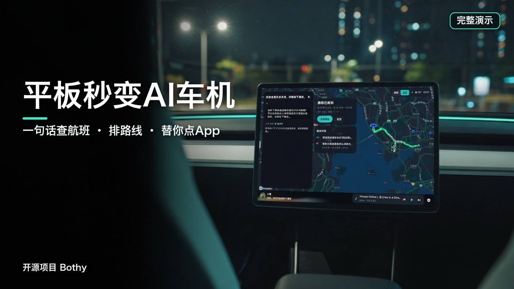
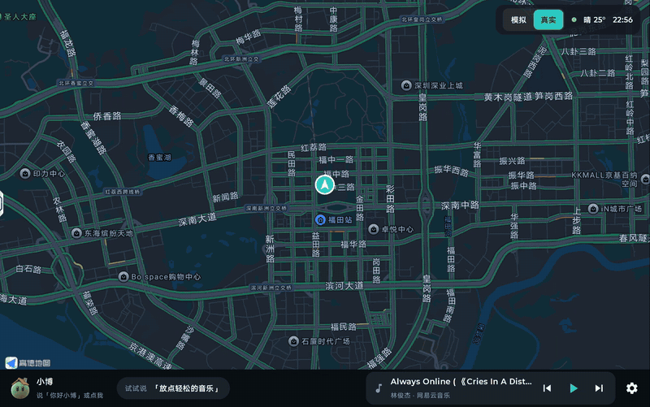
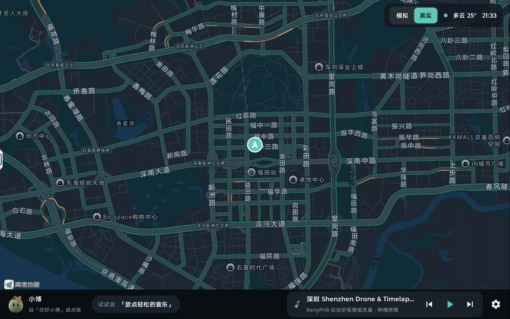

# Bothy

[](LICENSE)
[](https://github.com/NoHarry/android-agent-runtime)
[](#环境要求)

<p align="center"></p>

[English](README.md) | **中文**

**Bothy 把一台 Android 平板变成能对话的个人助手；装上 Bothy Playground，它就是一台车机。** 它是 [Android Agent Runtime](https://github.com/NoHarry/android-agent-runtime)（可嵌入的 Android agent 运行时）的演示，助手小博做的每件事都走运行时的公开 API。

▶ **[在 B 站看 12 分钟完整演示](https://www.bilibili.com/video/BV1g1nf6uEE8)**（带章节）

| 安装 | 平板变成 |
|------|----------|
| **Bothy** | 个人助手。在任何 App 上说「你好小博」或「OK Bothy」：联网查资料、做计划和提醒、播放暂停音乐和视频、替你操作别的 App（Android Use），还能把你的任何要求转交给你自己的云端 agent，比如 Grok Bot。 |
| **+ Bothy Playground** | 一台不能控车的车机：真实模式是带高德导航、用设备自己定位的车机界面；模拟模式有一辆模拟的车和一个模拟的家可以控制。架到车上，接人、途经点、到达提醒它都能安排。 |
| **+ 你自己的控车接口（封装成 MCP）** | 真正的车机。Playground 的虚拟车本身就是一个 MCP 服务（`set_climate`、`set_seat`、`set_window`、`set_trunk`……）；把你的车的控车接口也这样提供出来，在「连接应用」里按地址添加，小博就像控制虚拟车一样控制真车。 |

**车机不够智能？** 车上架一台装了 Bothy 的平板（Playground 用真实模式），不管原车带的是什么，座舱就多了一个会规划行程、到了提醒、放音乐、替你办事的助手。**还想要更多？** Bothy 是 MIT 协议、为扩展而做的：接任何 MCP 服务、加你自己的 skill，或者直接 fork，在同一个运行时上加你想要的功能。

**亮点**

- **像人一样做规划。**「朋友坐 CZ3956 来深圳，先接她，再去吃深夜食堂」：它联网查航班，找落地时还开着的店，最多 16 个途经点，计划一变就重新排。
- **会自己盯着。** 计划可以盯着车、家或任何服务，到达时、到点时、读数越线时主动提醒。
- **会用你的 App。** Android Use 读屏幕，在任何 App 里点击、滑动、输入；音乐和视频通过系统媒体会话控制。
- **能把任何事转交给你自己的 agent。** 点名 Grok Bot（或说「云端助手」），小博就把你的要求原样经 A2A 转交过去，不管是什么，办完用语音告诉你。
- **说不清的就画出来**：卡片、选项和调节面板直接画在屏幕上（A2UI）。
- **听得明白。** 本地唤醒词，中英文都行；知道是哪个座位在说话；可以随时打断它；一个开关就能换成端到端语音模型。
- **每一步都有记录。** 类似 Codex 的控制台，逐个工具调用回放每次运行。

Bothy（苏格兰山间小屋）向所有路人开放，小博就住在里面。

> **状态：0.x，持续开发中。**

## 5 分钟上手

不用装开发环境，只要一个模型 key。

1. **下载安装**：到 [Releases](https://github.com/NoHarry/bothy/releases) 下载最新的 `bothy-*.apk`（小博）和 `bothy-playground-*.apk`（虚拟车机，可选），装到 Android 平板或手机上（Android 7.0 以上，arm64）。
2. **填 DeepSeek key**：打开 Bothy，第一屏就是上手向导。到 [DeepSeek 开放平台](https://platform.deepseek.com/api_keys) 创建一个 API key，粘贴进去点「保存并检查」。
3. **（推荐）填豆包语音 key**：在[火山引擎豆包语音控制台](https://console.volcengine.com/speech/new/setting/activate?projectName=default)的「开通管理」里开通「语音合成2.0」和「端到端实时语音」，再到左侧「API Key」创建一个 key 粘贴进去。小博的声音更自然，还能用「端到端」连续对话。不填也行：小博用系统自带的语音说话。
4. **开权限**：向导里逐项点「去开启」。麦克风、悬浮窗必需；通知使用权（控制音乐）、无障碍（让小博操作别的 App）可选。
5. **说「你好小博」或「OK Bothy」**：试试「明天深圳天气怎么样」「明早八点提醒我带伞」「下一首」。打开 Bothy Playground 放在前台，就能在虚拟车机里让它开空调、开车窗、规划路线。

### 哪个功能需要哪个 key

| 功能 | 需要 |
|------|------|
| 对话、办事、联网搜索、提醒和计划、记忆、操作别的 App、媒体控制、日历、卡片和面板 | DeepSeek key |
| 唤醒词、语音识别 | 不需要（在设备上运行） |
| 小博说话 | 不需要（系统语音）；填了豆包语音 key 声音更自然 |
| 端到端语音对话 | 豆包语音 key |
| Playground 的虚拟车、虚拟家、天气 | 不需要（没有高德 key 时天气来自 Open-Meteo） |
| Playground 的地图、导航、搜地点 | 你自己的高德 key（见下） |

### 高德 key（可选，地图和导航用）

Playground 的地图和导航用高德 SDK，要用你自己申请的免费 key：

1. 打开[高德开放平台控制台](https://console.amap.com/dev/key/app)登录（个人开发者就行），「我的应用」→ 创建新应用 →「添加 Key」，服务平台选 **Android 平台**。
2. PackageName 填 `cc.noharry.bothy.playground`；发布版和调试版安全码 SHA1 都填
   `02:09:D5:0D:3B:C7:52:02:A2:1A:2E:E7:EB:01:5B:21:0D:74:13:5B`（Releases 里的 APK 用的签名）。
   自己编译的包签名不同：在 Playground 设置 →「高德 key」里能看到并一键复制它自己的包名和 SHA1。
3. 把生成的 key 粘贴到 Playground 设置 →「高德 key」，保存后车机自动重启，地图就出来了。

自己编译时也可以把 key 写进 `local.properties` 的 `AMAP_ANDROID_KEY`（见[运行演示 App](#运行演示-app)）。

## 两个 App

| 模块 | 做什么 |
|------|--------|
| `bothy-app` | 演示 App（平板优先）：调试控制台、设置、计划、语音、悬浮助手卡片 |
| `bothy-playground` | 第二个演示 App：用本机 MCP 服务提供一辆虚构的车和一个虚构的家，给 Bothy 操作（见[下文](#bothy-playground)） |

sample 依赖运行时的构件（`cc.noharry:agent-*`）；playground 不依赖任何模块，Bothy 像连其他 MCP 服务一样连它。

## 演示 App 能看到什么

<p align="center"><a href="https://www.bilibili.com/video/BV1g1nf6uEE8"></a></p>

完整演示（12 分钟，有声音、带章节）在 [B 站](https://www.bilibili.com/video/BV1g1nf6uEE8)。下面每段动图都是演示 App 在平板上实际运行、对着它说话录下来的；部分片段加了速，说明里都标了。

### 在车里和小博说话

<p align="center"></p>

说「你好小博」再提要求。它听的时候只显示一条小栏，滚动显示听到的字；接下请求后，卡片里依次出现你说的话、它调用的每个工具和最后的回答。它知道是谁在说话：标着「说话中」的座位就是你的，所以「我这边好热」会落到这个座位上。这里说「我有点冷」，空调从 24 度调到 28 度。*（原速）*

### 规划行程，开过去

<p align="center"></p>

「先去深圳北站，再去世界之窗」：小博按名字找到两个地点，用高德导航 SDK 规划经过它们的路线，先完整展示几秒，再开始模拟行驶和逐向引导。开车途中可以增加、删除、替换途经点或调整顺序（最多 16 个）；「科技园」这类笼统的名字会在行程其他地点附近找。演示里车停在深圳市民中心，不用设备的真实位置。*（2 倍速）*

### 真实导航，用设备自己的位置

<p align="center"></p>

车机右上角切到「真实」，就是一台真实的车机：高德的导航界面，用设备自己的定位，只留真实导航和小博。「我有个朋友坐南方航空 CZ3956 来深圳，你先去机场接她，然后带她去市区找个深夜食堂吃点东西」：小博联网查到航班凌晨 01:10 落地，规划好机场和深夜食堂，还提醒第一家 23:30 就关门，给出开到凌晨两点的；「接到她先去福田香格里拉酒店放行李，再去吃宵夜」又在路上加了酒店，换成开得晚的那家。说「用高德导航去……」则把路线交给高德地图 App。录制时平板的位置设在深圳市民中心。*（2 倍速，有剪辑；需开联网搜索）*

### 任何事都能转交给你自己的 agent

<p align="center"></p>

在「连接应用」里通过 `workspace/apps/android/tools/agent-relay` 自部署的中转，配对你自己的云端 agent，例如 Grok Bot。点名它（「让 Grok Bot……」，或者说「云端助手」），小博就把你的要求转交给它，不管你要什么：查资料、发邮件、设提醒、网购，凡是你的 agent 用你的账号能办的都行。任务经 A2A 交过去，对话照常继续，它办完回报时小博念给你听；问「Grok 那边怎么样了」可以看进度。没有配对时，小博也能直接在屏幕上打开它的 App 去问。*（1.5 倍速，剪掉了等待回报的时间）*

### 它画给你的卡片和面板

<p align="center"></p>

需要你选择或调节的时候，小博直接发界面而不是一段话（A2UI）：信息卡、选项、调节面板都由车机自己绘制。拖一拖、点一点、确定，选择就发回给小博执行；这里是 22 度、制冷。*（1.6 倍速）*

### 还有一个家

<p align="center"></p>

Playground 里还有一个小家：四个房间的灯、窗帘和空调，每个房间的人体传感器，门锁，扫地机器人，以及回家、离家、睡觉、观影、起床几个场景。数据会动，所以上面的客厅会慢慢降向 25 度，「客厅超过 28 度就开空调」这样的计划几分钟内就会触发。不在车机界面时，小博在 Bothy 的悬浮卡片里回答。*（1.5 倍速）*

### 它会用别的 App

<p align="center"></p>

打开 Android Use（一个需要你手动开启的无障碍服务）后，小博能读屏幕，在别的 App 里点击、滑动和输入。它的头像会提示马上要点哪里，它在操作时屏幕边缘会亮起；这里它在计算器上算出了 23 × 47。*（1.3 倍速）*

### 每一步都有记录

<p align="center"></p>

Bothy 本身的界面是一个类似 Codex 的开发者控制台。对话区列出每一次工具调用、各自的耗时和中途说的话；右侧 Board 跟踪这次运行、token 用量和缓存命中、工作区、MCP 服务、记忆和 skill。Trajectory 页从持久化的事件日志回放一次运行：先是模型和工具的时间轴，再按顺序列出每个事件，从请求、每次模型调用和 token 数，到每次工具调用（模型发起、后端执行、完成），并行执行的调用也一目了然。这里小博发现副驾座椅加热本来就关着，把氛围灯换成暖色，并检查车门和后备箱。*（1.15 倍速）*

### 还有这些

- **自带模型**：任何 OpenAI 或 Anthropic 兼容的服务，在 App 里配置；服务支持时可用流式、思考、服务端联网搜索和提示缓存。
- **设备上的模型**：内置的「本机模型」服务用 llama.cpp 在骁龙 NPU 上跑小模型，NPU 用不了时退回 CPU，对话不出设备。模型不随 App 安装，在设置里点哪个下哪个：Google Gemma 4 E4B（QAT Q4_0，5.2 GB）、阿里通义千问 Qwen3 4B Instruct 2507（Q4_0，2.4 GB）、面壁智能 MiniCPM5 2B（Q8_0，2.7 GB，开思考），都是 Apache-2.0。在 8 Elite Gen 5 平板上，模型加载后一轮几秒；它们比云端模型更常反问，能办的事也少一些。
- **接入公网上的 MCP**：「连接应用」里预置了现成的远程 MCP。公开服务点一下就能连，不需要 key：Kiwi.com 机票搜索、DeepWiki（GitHub 仓库问答）、Hugging Face Hub、Context7（开发文档）。需要 key 的填你自己的：高德地图、滴滴出行、麦当劳、瑞幸咖啡、腾讯文档。其他 Streamable HTTP 的 MCP 服务也可以按地址添加。
- **skill 和子 agent**：多日旅行规划会分派交通、住宿、每日行程三个子 agent，汇总成一张行程卡片；何时委派由主 agent 决定。
- **计划**：提醒、定时任务，以及监听服务状态（MCP 资源，或按间隔调用的只读工具）。比如「深圳飞成都 11 月 7 日的最低价低于 800 元时提醒我」就跑在 Kiwi.com 的公开搜索上。
- **语音**：设备端唤醒词（「你好，小博」或英文「OK Bothy」）和识别、轮次判断（可选的判断服务决定你是否说完、是不是在对小博说）、插话打断、语音播报；也可以切换到端到端语音模型。
- **你自己的云端 agent**：通过 `workspace/apps/android/tools/agent-relay` 里自部署的中转，配对你的个人 agent（例如 Grok Bot），把需要个人账号的事交给它。
- **离线**：也可以用模拟模型和 `bothy-app/src/main/assets/mcp/tools.json` 里的示例工具完全离线运行。

## Bothy Playground

<p align="center"></p>

`bothy-playground` 是另一个 App，它模拟一辆车的座舱和一个小家，在本机提供两个 MCP 服务
（`http://127.0.0.1:8790/cabin/mcp` 和 `/home/mcp`，Streamable HTTP，只监听本机回环地址）。它不连接任何真车或真实设备。

- **座舱**：空调、座椅加热和通风、车窗、车门和后备箱、车门锁、中控屏亮度和音量、氛围灯、音乐；还有谁坐在哪、谁在说话，所以「我这边好热」会落到说话人的座位上。
- **导航**：填了高德 key（见[上文](#高德-key可选地图和导航用)），就用高德导航 SDK 真实算路：按名字找地点（「科技园」这种笼统的名字会在这趟行程其他地点附近找），
  最多 16 个途经点，开车途中加、删、换、调整途经点，沿途搜索，以及模拟行驶。设置里可以让车停在深圳市民中心，不用设备的真实位置，方便在演示城市里演示。
- **车机界面**：座舱按车机屏幕布局（左边是车，右边三栏，下面是空调条）。它在前台时接管助手：Bothy 收起悬浮卡片，小博就在车机里。
  在这里唤醒（唤醒词，或者点小博）；听你说话时只显示一条小栏，滚动显示识别到的字；识别完开始干活时才弹出卡片，显示你的要求、
  它的思考过程（中文）、调用的每个工具、干活时说的话，最后是回答；计划到点也显示在这里；点 X 退出语音。地图会移到它找到的每个地点，先展示整条算好的路线，然后才开始导航。
- **小家**：四个房间的灯、窗帘、空调，每个房间的人体传感器，入户门锁，扫地机，以及场景（回家、离家、睡觉、观影、起床）。
- **读数会变**：温度会朝空调设定或室外温度变化，「模拟行驶」会耗电、缩短导航距离，所以「车里降到 24 度以下就把车窗都关上」、
  「客厅超过 28 度就开空调」这类计划几分钟内就会触发。两个服务都把状态发布成资源（`playground://cabin/state`、
  `playground://home/state`），Bothy 的计划可以监听。
- **也能手动改**：点座位让人上下车，长按座位让那里的人说话，点房间开关灯；侧栏里有全部控件和读数。手动改的会在记录里标「手动」，
  和真实变化一样会触发计划。

演示方法：两个 App 都装上，先打开 Bothy Playground，再在 Bothy 的「连接应用」里连上「虚拟座舱」和「虚拟小家」（不需要 key）。
让 Playground 留在前台，直接在车机里跟小博对话。电脑上的 MCP 客户端可以用 `adb forward tcp:8790 tcp:8790` 连同样的服务。

车机右上角的「模拟｜真实」随时切换：模拟模式是上面这辆虚构的车和小家；真实模式只留真实导航和小博，用设备自己的定位，
平板放到车上就能用。每次切换小博都会开一个新会话，前一个模式里说过的不会带过去。

导航要你自己的高德 Android key，在 Playground 设置 →「高德 key」里填（申请步骤见[上文](#高德-key可选地图和导航用)）；
没有 key 时地图的位置会显示申请指引，导航工具也会说明缺什么，其余功能照常。
车机接管助手靠签名级权限，所以两个 App 要用同一个签名（签名方法见[运行演示 App](#运行演示-app)）。

## 运行演示 App

两个 App 用的是发布在 Maven Central 上的运行时（版本见 `gradle.properties` 的 `agentRuntimeVersion`）。想基于运行时源码构建，就把它 clone 到本仓库旁边，Gradle 会从源码构建它，代替已发布的构件（见 `settings.gradle.kts`；加 `-PagentRuntimeDir=` 则回到已发布的版本）。

```bash
git clone https://github.com/NoHarry/bothy.git
cd bothy/workspace/apps/android
./gradlew :bothy-app:assembleDebug
./gradlew :bothy-playground:assembleDebug   # 可选：给 Bothy 操作的车和家
```

模型服务预置来自 `bothy-app/src/main/assets/model-provider-profiles.json`，它会打进 APK，所以**不含任何 API key**。
key 写在被 Git 忽略的 `workspace/apps/android/local.properties`：

```properties
# local.properties（永不提交）
AGENT_RUNTIME_PROVIDER_PROFILE_DEEPSEEK_API_API_KEY=your-key
```

key 名为 `AGENT_RUNTIME_PROVIDER_PROFILE_{PROFILE_ID}_API_KEY`，profile id 转大写、`-` 换成 `_`。为了方便，
`local.properties` 里的 key 会编进 debug 包；要发给别人的 APK 请加 `-PbothyEmbedLocalKeys=none`（或 `tts`）构建，
或者在 App 里填 key。

两个 App 默认用本机的调试签名；`local.properties` 里指定了自己的签名文件时，debug 和 release 都用它签，
换哪台电脑打的包都能覆盖安装：

```properties
BOTHY_SIGNING_STORE_FILE=/仓库外的路径/bothy-release.jks
BOTHY_SIGNING_STORE_PASSWORD=…
BOTHY_SIGNING_KEY_ALIAS=bothy
BOTHY_SIGNING_KEY_PASSWORD=…
```

签名文件和密码要备份好：丢了以后，新打的包就不能覆盖安装旧的了。

设备端语音模型已经提交在仓库里（sherpa-onnx 原生库在 `bothy-voice` 里），arm64 设备上开箱即用；
`tools/voice/fetch_voice_assets.py` 可以重新下载并校验它们。设备端对话模型的 llama.cpp 原生库提交在 `bothy-llm` 里，模型本身按需下载。

## 环境要求

- 演示 App：`minSdk 24`、`compileSdk 37`（运行时用到 `java.nio.file`，所以用 `desugar_jdk_libs_nio` 做 core library desugaring）
- JDK 17、Gradle 9.6、Android Gradle Plugin 9.4、Kotlin 2.4
- 平板优先，手机横着也能用。在手机上（最短边小于 600 dp）两个 App 都固定横屏：Bothy 控制台用紧凑布局，页面切换放在右侧竖栏；车机界面整体缩到四分之三；小博的悬浮卡片能放进竖屏的其他 App 之上。手机模拟器（Apple 芯片上用 arm64 镜像）可以跑这两个 App；高德地图在模拟器上要用软件渲染（启动时加 `-gpu swiftshader_indirect`），否则会在打开地图时崩溃。

## 友情链接

- [LINUX DO](https://linux.do)：新的理想型社区

## 许可证

[MIT](LICENSE)。第三方组件和提交的模型文件保留各自的许可，见 [THIRD_PARTY_NOTICES.md](THIRD_PARTY_NOTICES.md)。
